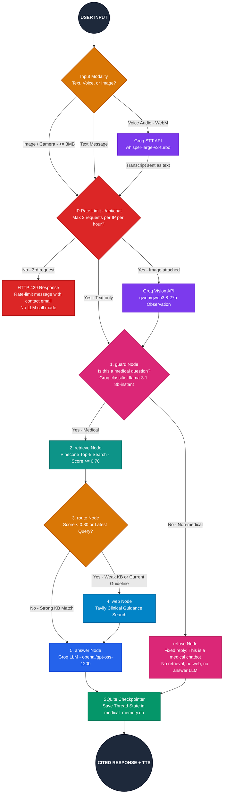

<div align="center">

# 🩺 MedGuide AI — Multimodal Medical RAG & Triage Assistant

<p align="center">
  <a href="https://www.python.org/"></a>
  <a href="https://fastapi.tiangolo.com/"></a>
  <a href="https://langchain-ai.github.io/langgraph/"></a>
  <a href="https://groq.com/"></a>
  <a href="https://www.pinecone.io/"></a>
  <a href="https://tavily.com/"></a>
  <a href="https://www.sqlite.org/"></a>
  <a href="mailto:shubham.shivare9112@gmail.com"></a>
</p>

**Transform text, voice, and medical image inputs into source-cited educational health guidance powered by Pinecone RAG, Tavily clinical search fallback, and LangGraph.**

</div>

---

## 🔒 Source Code Access Notice

> **Note:** The core proprietary production implementation, vector ingestion pipelines, and agent orchestration layers are hosted in an authenticated private repository.  
> If you are a recruiter, collaborator, or enterprise seeking to review the full codebase or evaluate live integration, please contact: **[shubham.shivare9112@gmail.com](mailto:shubham.shivare9112@gmail.com)**.

---
## 🏗️ Architecture & LangGraph Workflow



**Graph Color Legend:**
🟪 **Purple (`Multimodal Vision & Whisper STT`)** · 🟩 **Teal (`Pinecone Vector Retrieval`)** · 🟧 **Amber (`Score & Recency Router`)** · 🟦 **Cyan/Blue (`Tavily Web Search & Groq LLM Generation`)** · 🟥 **Red (`IP Rate Limiter`)** · 🩷 **Pink (`Medical-Only Guardrail & Refuse Nodes`)** · 🟢 **Emerald (`SQLite Persistent Memory`)**
## ✨ Core Highlights

- 🧬 **Hybrid Medical RAG (`LangGraph`)**: Retrieves clinical excerpts from *The Gale Encyclopedia of Medicine* (`data/Medical_book.pdf`) via **Pinecone** (`kb_min_score >= 0.70`) and routes to **Tavily** web search when internal match scores fall below `0.80` or when current/latest clinical guidelines are requested.
- 👁️ **Multimodal Vision & Voice Support**: Analyzes uploaded or live camera photos via **Groq Vision** (`qwen/qwen3.8-27b`), transcribes voice queries using **Groq Whisper** (`whisper-large-v3-turbo`), and reads answers aloud with browser **Web Speech TTS**.
- 💾 **Persistent SQLite Conversation Memory**: Maintains stateful multi-turn sessions using `langgraph-checkpoint-sqlite` (`SqliteSaver` in `medical_memory.db`) keyed by `X-Conversation-ID` / `thread_id`.
- 🛡️ **Clinical Safety Guardrails**: Enforces strict non-diagnostic system prompts, flags emergency symptoms immediately, and cites exact `[PDF p.N]` page numbers or external clinical URLs.
- 🚧 **Medical-Only Input Guardrail**: The first LangGraph node (`guard`) classifies every question with a small Groq model (`llama-3.1-8b-instant`, override via `GROQ_GUARD_MODEL`). Non-medical questions go to a `refuse` node and get a fixed *"This is a medical chatbot, kindly ask medical questions only"* reply, with no Pinecone, Tavily, or answer-LLM calls. If the classifier is unavailable, the bot fails open so standard workflows do not break.
- ⏱️ **IP Rate Limiting**: Each IP can make `2` `/api/chat` requests per hour (sliding window, `X-Forwarded-For` aware for cloud proxies). The 3rd request receives an HTTP `429` status code with contact information, preserving API quotas.

---
---
## 🔍 Observability & Tracing

1. **Deterministic Attribution**:
   - Every `/api/chat` response returns an attribution breakdown (`["pinecone", "tavily", "vision"]`), specific PDF page numbers with cosine similarity scores (`score`), clinical web URLs, and conversation thread IDs.
2. **LangSmith Integration**:
   - MedGuide AI supports native tracing via `langgraph>=0.3` and `langchain-groq>=0.3`. Adding your credentials to `.env` enables full node latency tracking, input validation telemetry, and graph visualization:
     ```env
     LANGCHAIN_TRACING_V2=true
     LANGCHAIN_ENDPOINT=https://api.smith.langchain.com
     LANGCHAIN_API_KEY=lsv2_pt_your_langsmith_key
     LANGCHAIN_PROJECT=MedGuide-AI
     ```

---

## ⚠️ Medical Disclaimer

> This project is designed as an educational reference architecture and **not** as a certified clinical diagnostic tool or medical device. Always consult a qualified medical professional for health conditions and immediately contact emergency services for acute symptoms.

---

## 📬 Contact & Inquiries

For demonstrations, code audits, or technical collaboration:
- **Email:** [shubham.shivare9112@gmail.com](mailto:shubham.shivare9112@gmail.com)
- **GitHub:** [@Shubh9966](https://github.com/Shubh9966)
